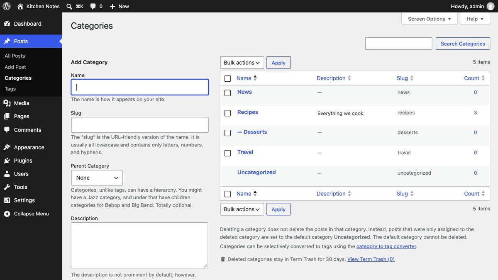
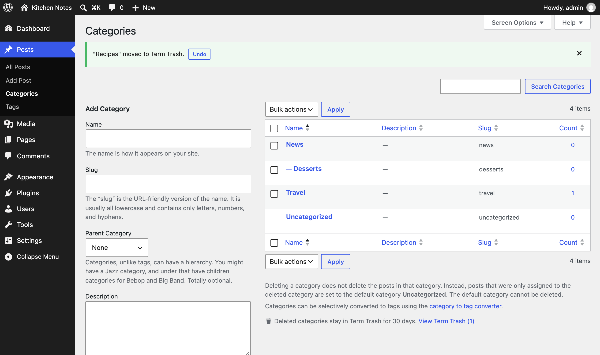
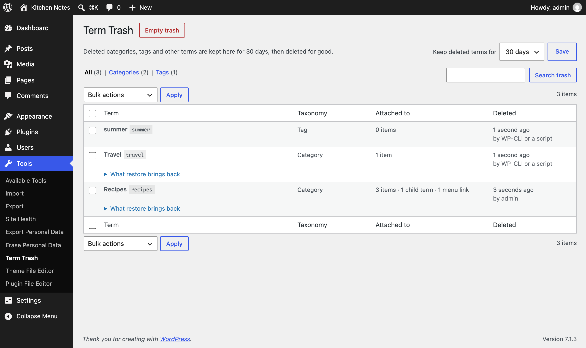
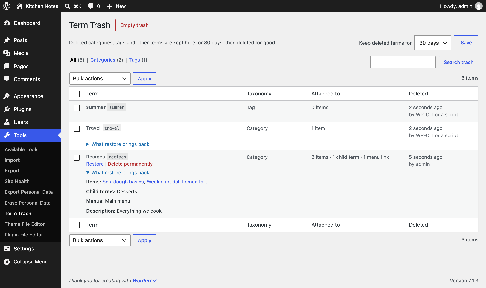

<p align="center"></p>

<h1 align="center">Term Trash</h1>

<p align="center">
  <a href="https://playground.wordpress.net/?blueprint-url=https://raw.githubusercontent.com/aryanjasala/term-trash/main/blueprint.json"></a>
  <a href="https://github.com/aryanjasala/term-trash/releases/latest"></a>
  
  
  <a href="LICENSE.md"></a>
  <br>
  <a href="https://github.com/aryanjasala/term-trash/actions/workflows/phpcs.yml"></a>
  <a href="https://github.com/aryanjasala/term-trash/actions/workflows/phpstan.yml"></a>
  <a href="https://github.com/aryanjasala/term-trash/actions/workflows/unit-tests.yml"></a>
  <a href="https://github.com/aryanjasala/term-trash/actions/workflows/e2e-tests.yml"></a>
  <a href="https://github.com/aryanjasala/term-trash/actions/workflows/plugin-check.yml"></a>
</p>

<p align="center">A trash for WordPress categories, tags and custom terms. Undo a delete in one click, or restore it later with its posts, child terms and menu links.</p>

<p align="center">
   Term Trash" width="880">
</p>

---

Posts and pages go to the trash when you delete them. Categories and tags don't: one click and the term is gone, its posts move to Uncategorized, its child categories move up a level and its menu links disappear. Term Trash keeps every deleted term for 30 days and puts all of that back on restore, under the same ID.

## Features

- **Undo** right after a delete, on every term screen, for single and bulk deletes
- **Same ID** on restore, so navigation blocks, widgets and shortcodes that store the ID work again
- **Everything comes back**: term meta, posts (in the same order), child terms and menu links in their menu position
- Posts that only got **Uncategorized** because of the delete lose it again
- **Tools > Term Trash**: taxonomy tabs, search, bulk restore and delete, Empty trash, and what each restore brings back
- Kept for **7, 30, 90 or 365 days**, then a daily task deletes them for good
- Categories, tags, WooCommerce product categories and attributes, and any custom taxonomy with an admin screen

## Install

1. Download `term-trash.zip` from the [latest release](https://github.com/aryanjasala/term-trash/releases/latest).
2. In WordPress, go to **Plugins > Add New Plugin > Upload Plugin**, choose the zip and activate it.

Or with WP-CLI:

```sh
wp plugin install https://github.com/aryanjasala/term-trash/releases/latest/download/term-trash.zip --activate
```

Needs WordPress 6.6+ and PHP 7.4+. To try it first, the **Try in WordPress Playground** badge opens a throwaway WordPress in your browser with the plugin and some demo content.

## Quick look

Everything on the screen is also on WP-CLI:

```sh
wp term-trash list --taxonomy=category
wp term-trash restore 42
wp term-trash delete --all
```

## Screenshots

<table>
  <tr>
    <td width="50%" valign="top"><br><sub>Undo right after deleting a category</sub></td>
    <td width="50%" valign="top"> Term Trash"><br><sub>Tools > Term Trash</sub></td>
  </tr>
  <tr>
    <td width="50%" valign="top"><br><sub>What a restore brings back</sub></td>
  </tr>
</table>

## Documentation

| Doc | What it covers |
| --- | --- |
| [Reference](docs/REFERENCE.md) | Hooks, WP-CLI, the PHP API and what is stored |
| [Development](docs/DEVELOPMENT.md) | Local setup, commands and tests |
| [Contributing](docs/CONTRIBUTING.md) | Pull requests, required checks and PR titles |
| [Releasing](docs/RELEASING.md) | How merged pull requests become releases |
| [Security](docs/SECURITY.md) | Reporting a vulnerability |
| [readme.txt](readme.txt) | What WordPress.org shows, with the FAQ and changelog |

## Project structure

```
term-trash.php           plugin header and PSR-4 autoloader
src/
├── Plugin.php           creates the services
├── Snapshot.php         everything about a term at the moment it was deleted
├── Snapshotter.php      captures terms on pre_delete_term, saves on delete_term
├── Restorer.php         puts a term, its posts, children and menu links back
├── Trash.php            storage (a hidden post type) and queries
├── Purger.php           daily cleanup after the retention period
├── Admin/               trash screen, list table, Undo notices
└── Cli/Command.php      wp term-trash
assets/                  term screen script and styles
tests/
├── Unit/                PHPUnit
└── e2e/                 Playwright specs and the Docker site
.wordpress-org/          screenshots
docs/                    reference, development, contributing, releasing
```

## License

[GPL-2.0-or-later](LICENSE.md) © Aryan Jasala
